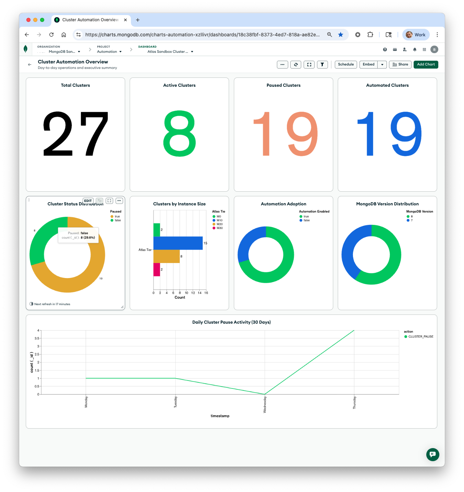
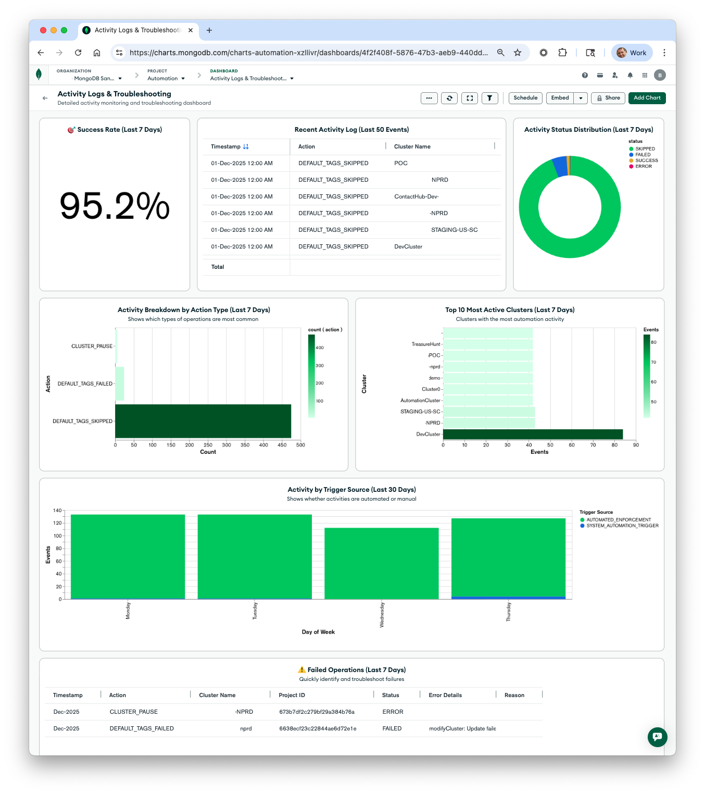

# Atlas Cluster Automation Dashboard Setup Guide

**Complete guide for creating your Atlas Charts dashboards.**

## Overview

This guide will help you create **two focused dashboards** to visualize your cluster automation data:

1. **Cluster Automation Overview** - Primary dashboard for day-to-day operations and executive view
2. **Activity Logs & Troubleshooting** - Detailed monitoring and troubleshooting dashboard

### Why Two Dashboards?

- **Better Performance** - Faster load times with focused chart sets
- **Clear Purpose** - Operations overview vs. deep-dive troubleshooting
- **Different Audiences** - Executives/managers vs. operations/development teams
- **Easier Navigation** - No scrolling through 15+ charts to find what you need

This guide provides step-by-step instructions for creating both dashboards with all recommended charts.

## Data Sources

Your automation system populates these collections:

### 1. `cluster_status` Collection
Contains individual cluster documents with:
```javascript
{
  _id: ObjectId("..."),
  name: "cluster-name",                    // Cluster name (NOT clusterName)
  projectId: "...",
  projectName: "...", 
  instanceSize: "M10|M20|M30|...",
  mongoDBVersion: "7|8",
  paused: true/false,
  createDate: "2025-04-23T16:19:17Z",     // ISO date string
  ageInDays: 96,                          // Calculated age since creation
  autoscaling: true/false,
  status: "ACTIVE|PAUSED|...",            // Current cluster status
  
  // Ownership and organizational fields
  ownedBy: "user@company.com",
  supportedBy: "support@company.com", 
  projectStatus: "Testing|Production|...",
  
  // Automation and scheduling
  automationEnabled: true/false,
  hasSchedule: true/false,
  pauseHour: 22,                          // Hour of day to pause (0-23)
  pauseDaysOfWeek: [0,1,2,3,4,5,6],      // Array of days (0=Sunday)
  pauseDaysOfWeekDisplay: "Sun, Mon, Tue, Wed, Thu, Fri, Sat",
  timezone: "America/New_York",
  scheduleTag: "days:0.1.2.3.4.5.6:hour:22:timezone:America-New_York",
  scheduleDisplay: "Sun, Mon, Tue, Wed, Thu, Fri, Sat at 22:00 America/New_York",
  
  lastUpdated: ISODate(...),
  dataSource: "atlas-api-tags"
}
```


### 2. `dashboard_summary` Collection
Contains a single document with overall metrics:
```javascript
{
  _id: "dashboard_summary",
  totalAtlasProjects: 20,
  totalProjectsWithScheduledClusters: 9,
  totalClusters: 14,
  pausedClusters: 2,
  activeClusters: 12,
  automationEnabledClusters: 2,
  lastRefreshed: ISODate("2025-07-28T17:45:07.171Z")
}
```
*Note: These are live metrics from your actual database as of last refresh*

### 3. `activity_logs` Collection
Activity tracking with detailed audit trail:
```javascript
{
  _id: ObjectId("..."),
  timestamp: ISODate("2025-12-04T14:45:01.724Z"),
  action: "CLUSTER_PAUSE|CLUSTER_RESUME|DEFAULT_TAGS_ADDED|DEFAULT_TAGS_SKIPPED|DEFAULT_TAGS_FAILED|SCHEDULED_TAG_ENFORCEMENT_FAILED",
  projectId: "...",
  clusterName: "my-cluster" || null,           // null for org-level events
  triggerSource: "SCHEDULED_TRIGGER|MANUAL_TRIGGER|AUTOMATED_ENFORCEMENT|UNKNOWN",
  status: "SUCCESS|FAILED|ERROR|SKIPPED",
  
  // Fields specific to pause/resume operations:
  targetState: "PAUSED|ACTIVE",                // Only for CLUSTER_PAUSE/CLUSTER_RESUME
  message: "Cluster my-cluster set to PAUSED", // Only for CLUSTER_PAUSE/CLUSTER_RESUME
  
  // Details object (structure varies by action type):
  details: {
    // For pause/resume operations:
    functionCaller: "setClusterPauseState",
    
    // For tag operations (DEFAULT_TAGS_ADDED):
    tagsAdded: [{key: "OWNED_BY", value: "unassigned"}],
    totalTagsAdded: 1,
    
    // For skipped operations (DEFAULT_TAGS_SKIPPED):
    reason: "Cluster is paused - tags cannot be updated",
    attemptedTags: [...],
    totalTagsAttempted: 0,
    
    // For failed operations (DEFAULT_TAGS_FAILED):
    error: "error message",
    attemptedTags: [...]
  }
}
```

**Common Action Types:**
- `CLUSTER_PAUSE` - Cluster was paused (has `message` and `targetState` fields)
- `CLUSTER_RESUME` - Cluster was resumed (has `message` and `targetState` fields)
- `DEFAULT_TAGS_ADDED` - Required organizational tags were added (has `details.tagsAdded`)
- `DEFAULT_TAGS_SKIPPED` - Tag operation skipped (has `details.reason`)
- `DEFAULT_TAGS_FAILED` - Tag operation failed (has `details.error`)
- `SCHEDULED_TAG_ENFORCEMENT_FAILED` - Scheduled trigger failure (has `details.error`, **`clusterName` and `projectId` are null** - this is an org-level failure)

**Note:** Records with `action: "SCHEDULED_TAG_ENFORCEMENT_FAILED"` have `clusterName: null` and `projectId: null` because they represent system-level failures, not cluster-specific issues.

## Dashboard Architecture

You will create **two dashboards**:

### Dashboard 1: "Cluster Automation Overview" ⭐ PRIMARY
**Purpose:** Day-to-day operations and executive summary  
**Audience:** Everyone  
**Charts:** 10 charts showing cluster status, automation adoption, and activity trends  
**Refresh:** Every 30 minutes (auto)

### Dashboard 2: "Activity Logs & Troubleshooting" 🔍 SECONDARY
**Purpose:** Deep-dive monitoring and troubleshooting  
**Audience:** Operations team, developers  
**Charts:** 8 charts focused on activity logs, success rates, and failures  
**Refresh:** Every 5 minutes (auto)

---

## Part 1: Cluster Automation Overview Dashboard

### Step 1: Create the Overview Dashboard

1. Navigate to [MongoDB Atlas](https://cloud.mongodb.com)
2. Select your project
3. Click **Charts** in the left navigation
4. Click **Create Dashboard**
5. Name it: **"Cluster Automation Overview"**
6. Optional description: "Primary dashboard for cluster operations and automation monitoring"

### Step 2: Overview Metrics Cards


Create metric cards using the `dashboard_summary` collection:

#### Chart 1.1: Total Clusters Card
- **Data Source:** `dashboard_summary` collection
- **Chart Type:** Number
- **Value:** `totalClusters`
- **Title:** "Total Clusters"

#### Chart 1.2: Active Clusters Card
- **Data Source:** `dashboard_summary` collection
- **Chart Type:** Number
- **Value:** `activeClusters` 
- **Title:** "Active Clusters"
- **Color:** Green

#### Chart 1.3: Paused Clusters Card
- **Data Source:** `dashboard_summary` collection
- **Chart Type:** Number
- **Value:** `pausedClusters`
- **Title:** "Paused Clusters"
- **Color:** Orange

#### Chart 1.4: Automation Enabled Card
- **Data Source:** `dashboard_summary` collection
- **Chart Type:** Number
- **Value:** `automationEnabledClusters`
- **Title:** "Automated Clusters"
- **Color:** Blue

### Step 3: Status Distribution Charts


#### Chart 1.5: Cluster Status Donut Chart
- **Data Source:** `cluster_status` collection
- **Chart Type:** Donut Chart
- **Arc:** `paused` (set as the Arc field)
- **Value:** Count of documents
- **Title:** "Cluster Status Distribution"
- **Labels:** Map `true → "Paused"`, `false → "Active"`


#### Chart 1.6: Instance Size Distribution
- **Data Source:** `cluster_status` collection
- **Chart Type:** Colored Column Chart
- **X-Axis (Category):** `instanceSize`
  - **Sort By:** Value, Descending
- **Color:** `instanceSize` (or any field)
  - **Aggregate:** Count
- **Title:** "Clusters by Instance Size"
- **Note:** Each instance size gets a different color automatically


#### Chart 1.7: Projects Overview
- **Data Source:** `cluster_status` collection
- **Chart Type:** Colored Column Chart
- **X-Axis (Category):** `projectName`
  - **Sort By:** Value, Descending
- **Color:** `projectName` (or any field)
  - **Aggregate:** Count
- **Title:** "Clusters per Project"
- **Note:** Each project gets a different color automatically

### Step 4: Automation Analytics


#### Chart 1.8: Scheduled vs Manual Clusters
- **Data Source:** `cluster_status` collection
- **Chart Type:** Stacked Column Chart
- **X-Axis (Category):** `projectName`
- **Y-Axis:** `automationEnabled` (or any field)
  - **Aggregate:** Count
- **Series:** `automationEnabled`
- **Title:** "Automated vs Manual Clusters by Project"
- **Colors:** Customize - Blue for "Automated", Gray for "Manual"
- **Note:** This shows the breakdown of automated vs manual clusters for each project

### Step 6: Activity Overview

Add one key activity chart to the overview dashboard to show that automation is working:

#### Chart 1.9: Activity Timeline (Last 30 Days)
- **Data Source:** `activity_logs` collection
- **Chart Type:** Line Chart
- **X-Axis:** `timestamp` 
  - **Binning:** By Day
- **Y-Axis:** `action` (or any field)
  - **Aggregate:** Count
- **Series:** `action` (creates separate lines for each action type)
- **Title:** "Daily Automation Activity (30 Days)"
- **Colors:** 
  - Green for `CLUSTER_RESUME`
  - Orange for `CLUSTER_PAUSE`
  - Blue for tag-related actions
- **Filter:** `timestamp >= (current date - 30 days)`

### Step 7: Cost Optimization Insights

#### Chart 1.10: MongoDB Version Distribution 
- **Data Source:** `cluster_status` collection
- **Chart Type:** Donut Chart
- **Label:** `mongoDBVersion`
- **Arc:** `mongoDBVersion`
  - **Aggregate:** Count of documents
- **Title:** "MongoDB Version Distribution"
- **Colors:** Blue gradient

---

## Part 2: Activity Logs & Troubleshooting Dashboard

### Step 1: Create the Activity Dashboard

1. In Atlas Charts, click **Create Dashboard**
2. Name it: **"Activity Logs & Troubleshooting"**
3. Optional description: "Detailed activity monitoring and troubleshooting dashboard"

### Step 2: Success Rate & Health Metrics

The `activity_logs` collection provides detailed audit trails of all automation activities. Create these charts to monitor system health.

#### Chart 2.1: Success Rate Gauge (PRIMARY METRIC)
- **Data Source:** `activity_logs` collection
- **Chart Type:** Number Chart

**Configuration Steps:**
1. In Atlas Charts, select **Number** chart type
2. In the data source panel, look for **"Add Aggregation Pipeline"** or **"Pipeline"** option
3. Add this aggregation pipeline:

```javascript
[
  {
    $match: {
      timestamp: { $gte: new Date(Date.now() - 7*24*60*60*1000) }
    }
  },
  {
    $group: {
      _id: null,
      total: { $sum: 1 },
      successful: {
        $sum: { 
          $cond: [
            { $in: ["$status", ["SUCCESS", "SKIPPED"]] }, 
            1, 
            0
          ] 
        }
      }
    }
  },
  {
    $project: {
      successRate: { 
        $multiply: [
          { $divide: ["$successful", "$total"] },
          100
        ]
      }
    }
  }
]
```

4. Drag the `successRate` field to the **Number** encoding
5. For the **Aggregate** dropdown, select **"First"** or **"Max"** (both work since there's only one value)
6. Set **Number Format** to show 1 decimal place
7. Optionally add "%" suffix in the number formatting options

- **Title:** "🎯 Success Rate (Last 7 Days)"
- **Display:** As percentage (e.g., 95.5%)
- **Size:** Make this large and prominent at the top
- **Note:** This is your primary health metric - shows overall automation reliability
- **Success Definition:** Counts both `SUCCESS` and `SKIPPED` as successful outcomes
  - `SUCCESS` = Operation completed successfully
  - `SKIPPED` = Operation intentionally skipped (cluster already in target state, free tier limitations, etc.)
  - `FAILED` / `ERROR` = Actual failures requiring attention

### Step 3: Activity Analysis Charts

#### Chart 2.2: Recent Activity Log Table
- **Data Source:** `activity_logs` collection
- **Chart Type:** Table

**Configuration Steps:**
1. Add columns by dragging fields to the **Columns** area:
   - `timestamp` - When the action occurred
   - `action` - What happened
   - `clusterName` - Which cluster (null for org-level events)
   - `status` - Result (SUCCESS/FAILED/SKIPPED)
   - `triggerSource` - What triggered it

2. Configure sorting and limits:
   - Click on the `timestamp` field in the Columns area
   - Under **Sort By**, select `timestamp` and choose **Descending** (newest first)
   - Under **Limit Results**, set to **50** to show only the 50 most recent entries

- **Title:** "Recent Activity Log (Last 50 Events)"
- **Optional Filter:** Add time range filter if needed (e.g., last 30 days)
- **Note:** `clusterName` will be null for org-level events like `SCHEDULED_TAG_ENFORCEMENT_FAILED`

#### Chart 2.3: Activity by Status (Donut Chart)
- **Data Source:** `activity_logs` collection
- **Chart Type:** Donut Chart
- **Label:** `status`
- **Arc:** `status` (or any field)
  - **Aggregate:** Count
- **Title:** "Activity Status Distribution (Last 7 Days)"
- **Colors:** 
  - Green for `SUCCESS`
  - Red for `FAILED`
  - Yellow for `SKIPPED`
  - Orange for `ERROR`
- **Filter:** `timestamp >= (current date - 7 days)`

#### Chart 2.4: Activity by Action Type
- **Data Source:** `activity_logs` collection
- **Chart Type:** Colored Bar
- **Y-Axis (Category):** `action`
  - **Sort By:** Value, Descending
- **Color:** `action` (or any field)
  - **Aggregate:** Count
- **Title:** "Activity Breakdown by Action Type (Last 7 Days)"
- **Filter:** `timestamp >= (current date - 7 days)`
- **Description:** Shows which types of operations are most common

#### Chart 2.5: Most Active Clusters
- **Data Source:** `activity_logs` collection
- **Chart Type:** Colored Bar
- **Aggregation Pipeline:**
  ```javascript
  [
    {
      $match: {
        timestamp: { $gte: new Date(Date.now() - 7*24*60*60*1000) },
        clusterName: { $ne: null }
      }
    },
    {
      $group: {
        _id: "$clusterName",
        activityCount: { $sum: 1 }
      }
    },
    { $sort: { activityCount: -1 } },
    { $limit: 10 }
  ]
  ```
- **Y-Axis (Category):** `_id` (cluster name)
  - **Sort By:** Value, Descending
- **Color:** `activityCount`
  - **Aggregate:** Sum (or Max, since there's only one value per cluster)
- **Title:** "Top 10 Most Active Clusters (Last 7 Days)"
- **Description:** Clusters with the most automation activity
- **Note:** The pipeline already sorts and limits to top 10, but you can also sort in the chart

#### Chart 2.6: Activity by Trigger Source
- **Data Source:** `activity_logs` collection
- **Chart Type:** Stacked Column Chart
- **X-Axis:** `timestamp` 
  - **Binning:** By Day
- **Y-Axis:** `triggerSource` (or any field)
  - **Aggregate:** Count
- **Series:** `triggerSource`
- **Title:** "Activity by Trigger Source (Last 30 Days)"
- **Colors:** Different color for each trigger source
- **Filter:** `timestamp >= (current date - 30 days)`
- **Description:** Shows whether activities are automated or manual

### Step 4: Troubleshooting & Alerts

#### Chart 2.7: Failed Operations Alert Table
- **Data Source:** `activity_logs` collection
- **Chart Type:** Table
- **Columns:**
  - `timestamp` - When the failure occurred
  - `action` - What operation failed
  - `clusterName` - Which cluster (null for org-level failures)
  - `projectId` - Which project (null for org-level failures)
  - `status` - FAILED or ERROR
  - `message` - Error description (for CLUSTER_PAUSE/CLUSTER_RESUME failures)
  - `details.error` - Error message (for tag operation failures)
- **Filter:** 
  - `status` in ["FAILED", "ERROR"]
  - `timestamp >= (current date - 7 days)`
- **Sort:** `timestamp` descending
- **Title:** "⚠️ Failed Operations (Last 7 Days)"
- **Description:** Quickly identify and troubleshoot failures
- **Notes:** 
  - `clusterName` and `projectId` will be null for org-level failures like `SCHEDULED_TAG_ENFORCEMENT_FAILED`
  - For `CLUSTER_PAUSE`/`CLUSTER_RESUME` failures: error info is in `message` field
  - For tag operation failures (`DEFAULT_TAGS_FAILED`): error info is in `details.error` field
  - `status: "ERROR"` is only used for critical/unexpected errors in pause/resume operations
  - `status: "FAILED"` is used for expected failures (e.g., tag operations that fail)

## Embedding Charts

To embed charts in your web application:

1. Click the **...** menu on any chart
2. Select **Embed Chart**
3. Choose embedding options:
   - **Verified signature** (recommended for production)
   - **Unauthenticated access** (for public dashboards)
4. Copy the provided iframe code
5. Add to your HTML:

```html
<iframe 
  src="https://charts.mongodb.com/charts-project-xxxxx/embed/charts?id=chart-id-xxxxx"
  width="100%" 
  height="400">
</iframe>
```

## Dashboard Configuration

### Auto-Refresh Settings

**Dashboard 1 (Cluster Automation Overview):**
- Set auto-refresh to **30 minutes**
- Data updates via `syncClusterStatusTrigger` every 15 minutes, so 30-minute refresh is sufficient
- Good for general monitoring without excessive refreshes

**Dashboard 2 (Activity Logs & Troubleshooting):**
- Set auto-refresh to **5 minutes**
- Activity logs update in real-time as operations occur
- Faster refresh for active troubleshooting

### Manual Refresh
- Click the refresh icon in Atlas Charts anytime
- Use when you need immediate updates after making changes

## Sharing and Permissions

1. Click **Share Dashboard** 
2. Choose sharing level:
   - **Private:** Only you can view
   - **Team:** Atlas project members can view
   - **Public:** Anyone with link can view
3. Set permissions (view/edit)
4. Generate sharing link

---

## Dashboard Layouts

### Dashboard 1: Cluster Automation Overview



<!-- Hidden for reference
```
┌─────────────┬─────────────┬─────────────┬─────────────┐
│ Total       │ Active      │ Paused      │ Automated   │
│ Clusters    │ Clusters    │ Clusters    │ Clusters    │
│    23       │    15       │     8       │    20       │
└─────────────┴─────────────┴─────────────┴─────────────┘

┌─────────────────────┬─────────────────────────────────┐
│ Status Distribution │ Instance Size Distribution      │
│   🥧 Donut Chart    │   📊 Bar Chart                  │
└─────────────────────┴─────────────────────────────────┘

┌─────────────────────┬─────────────────────────────────┐
│ Clusters per        │ Automation Adoption             │
│ Project             │                                 │
│   📊 Bar Chart      │   🍩 Donut Chart                │
└─────────────────────┴─────────────────────────────────┘

┌─────────────────────────────────────────────────────────┐
│ Daily Automation Activity (30 Days)                     │
│   📈 Line Chart - Shows automation is working           │
└─────────────────────────────────────────────────────────┘

┌─────────────────────────────────────────────────────────┐
│ MongoDB Version Distribution                            │
│   🍩 Donut Chart                                        │
└─────────────────────────────────────────────────────────┘
```
--> 
**Use this for:** Daily monitoring, executive reports, demos

---

### Dashboard 2: Activity Logs & Troubleshooting

<!-- Hidden for reference

```
┌─────────────────────────────────────────────────────────┐
│ 🎯 Success Rate (Last 7 Days)                           │
│              95.5%                                      │
│   (Large, prominent number chart)                       │
└─────────────────────────────────────────────────────────┘

┌─────────────────────┬─────────────────────────────────┐
│ Activity Status     │ Activity by Action Type         │
│   🍩 Donut Chart    │   📊 Colored Bar                │
└─────────────────────┴─────────────────────────────────┘

┌─────────────────────┬─────────────────────────────────┐
│ Most Active         │ Activity by Trigger Source      │
│ Clusters            │                                 │
│   📊 Bar Chart      │   📊 Stacked Column             │
└─────────────────────┴─────────────────────────────────┘

┌─────────────────────────────────────────────────────────┐
│ Recent Activity Log (Last 50 Events)                    │
│   📋 Detailed table for audit trail                    │
└─────────────────────────────────────────────────────────┘

┌─────────────────────────────────────────────────────────┐
│ ⚠️ Failed Operations (Last 7 Days)                      │
│   📋 Alert table - Investigate these first!            │
└─────────────────────────────────────────────────────────┘
```
-->
**Use this for:** Troubleshooting, monitoring health, investigating failures

## Navigation Between Dashboards

Since you'll have two dashboards, here's how to navigate:

1. **Bookmark both dashboards** in your browser
2. **Name them clearly** in Atlas Charts so they're easy to find
3. **Share both links** with your team:
   - Send "Overview" dashboard to executives/managers
   - Send "Troubleshooting" dashboard to operations/dev teams

## Next Steps

### For First-Time Setup:
1. ✅ **Create Dashboard 1 (Overview)** - Start here, ~30 minutes
2. ✅ **Create Dashboard 2 (Activity)** - Add when needed, ~20 minutes
3. ✅ **Configure auto-refresh** - 15 min for Overview, 5 min for Activity
4. ✅ **Share dashboards** with appropriate teams
5. ✅ **Bookmark for quick access**

### Ongoing:
- Check **Overview dashboard** daily for operations monitoring
- Use **Activity dashboard** when troubleshooting issues
- Review **Failed Operations table** weekly
- Monitor trends to identify optimization opportunities

## Quick Reference

| Task | Dashboard to Use |
|------|------------------|
| Daily monitoring | Cluster Automation Overview |
| Executive reports | Cluster Automation Overview |
| Troubleshooting failures | Activity Logs & Troubleshooting |
| Investigating specific cluster | Activity Logs & Troubleshooting (filter by cluster) |
| Checking success rates | Activity Logs & Troubleshooting |
| Demo to stakeholders | Cluster Automation Overview |

Your cluster automation data is now ready for powerful visualization in Atlas Charts! 📊✨
